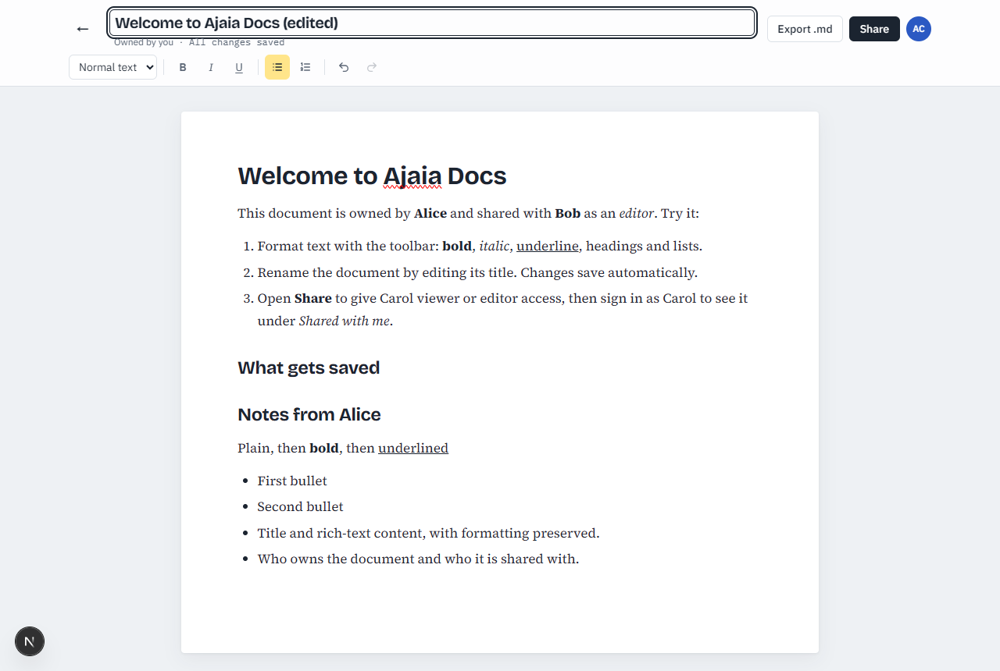
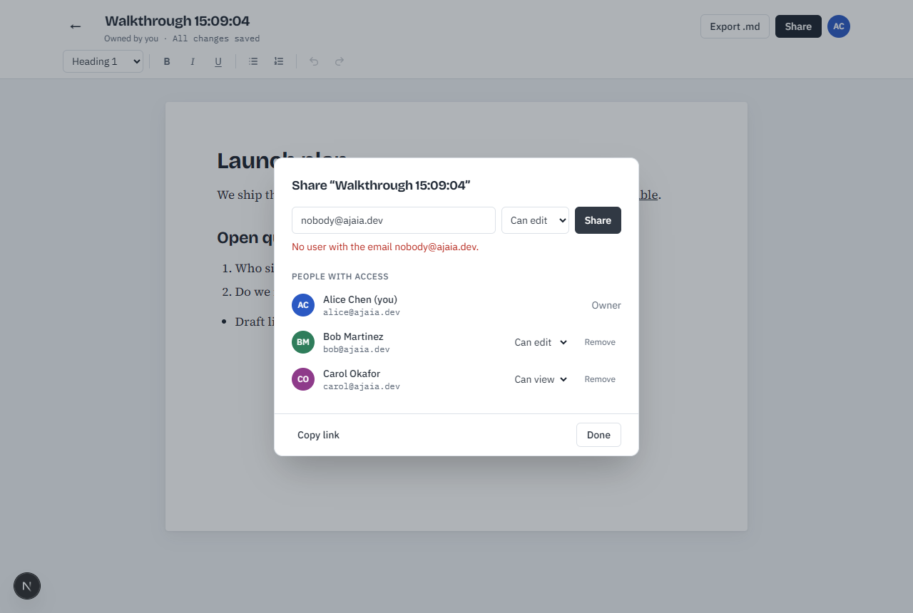
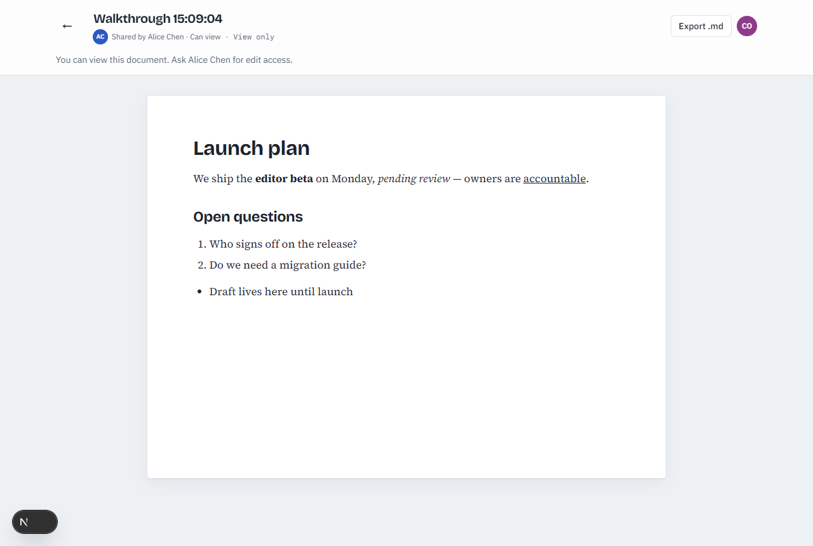
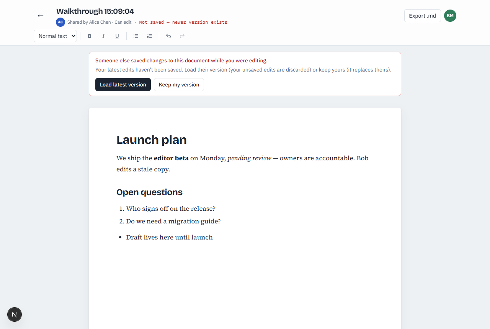

# Ajaia Docs

A lightweight collaborative document editor: create and format documents, import files, share them
with teammates as viewers or editors, and export to Markdown.

- **Live app:** https://ajaia-docs-xi-ashy.vercel.app
- **Architecture & tradeoffs:** [ARCHITECTURE.md](ARCHITECTURE.md)
- **How AI was used:** [AI_WORKFLOW.md](AI_WORKFLOW.md)

## Demo accounts

All seeded accounts share the password **`ajaia-demo`** (the login page lists them and can fill the form for you).

| Name | Email | Seeded state |
|---|---|---|
| Alice Chen | `alice@ajaia.dev` | Owns "Welcome to Ajaia Docs" |
| Bob Martinez | `bob@ajaia.dev` | Has **edit** access to Alice's welcome doc |
| Carol Okafor | `carol@ajaia.dev` | Nothing shared yet — use her to test sharing |

### A 2-minute review path

1. Sign in as **Alice** → open *Welcome to Ajaia Docs* → format some text, rename it. The status reads
   *All changes saved* after each pause.
2. Click **Share** → add `carol@ajaia.dev` as **Can view**.
3. Sign out → sign in as **Carol** → the doc is under **Shared with you**, opens read-only.
4. Sign in as **Bob** (editor) in a second browser/incognito window and edit the same doc as Alice. The
   second person to save gets a *"Someone else saved changes"* banner instead of silently overwriting.
5. Back on the dashboard: **Import file** with one of the files in [`samples/`](samples/) (`.docx`, `.md`,
   `.txt`), then **Export .md** from the editor.

## Screenshots

| Editor | Sharing |
|---|---|
|  |  |
| **Viewer (read-only)** | **Concurrent-edit conflict** |
|  |  |

## Features

| Area | What works |
|---|---|
| Documents | Create, rename (inline title), edit, delete (owner only), reopen with formatting intact |
| Rich text | Bold, italic, underline, Heading 1–3, bulleted and numbered lists, undo/redo, keyboard shortcuts |
| Saving | Debounced autosave (~0.8 s), `Ctrl/Cmd+S` to save now, status indicator, retry on network errors, unsaved-changes guard |
| File import | **.txt, .md, .docx up to 4 MB** → a new document (headings, emphasis, lists and links preserved) |
| Sharing | Owner shares by email as **viewer** or **editor**, changes role, revokes; "Owned by you" vs "Shared with you" lists |
| Access control | Enforced on the server for every request: strangers get 404, viewers get 403 on writes |
| Concurrency | Version-checked saves: stale writes get 409 and a conflict banner (load latest / keep mine) |
| Export | Download any document you can read as Markdown |

Supported import types are limited to `.txt`, `.md` and `.docx` (stated in the UI next to the Import
button). Images, PDFs and legacy `.doc` files are rejected with a clear message.

## Run locally

Requirements: **Node.js 20.9+** (developed on Node 22). No database or env setup needed.

```bash
npm install
npm run dev          # http://localhost:3000
```

Without `DATABASE_URL`, the app uses **PGlite** — real Postgres compiled to WASM — stored in
`./.data/pglite`. Tables and demo users are created automatically on first request. Delete `.data/`
to reset. Without `SESSION_SECRET`, local dev generates a random one per process (you'll need to sign in
again after restarting the server).

Optional configuration (see [.env.example](.env.example)):

| Variable | Purpose |
|---|---|
| `DATABASE_URL` | Postgres connection string (Neon in production). Unset → embedded PGlite |
| `SESSION_SECRET` | HMAC key for session cookies. **Required on Vercel**; optional locally |

### Scripts

```bash
npm test             # Vitest: access rules, sharing + conflict integration tests, import/export, sessions
npm run typecheck    # tsc --noEmit
npm run lint         # ESLint (next/core-web-vitals)
npm run build        # production build
npm run e2e          # browser walkthrough of every flow against a running app (needs Google Chrome);
                     # BASE_URL=https://… to target a deployment, SCREENSHOTS=1 to refresh docs/screenshots
```

The e2e walkthrough works in its own new document and deletes what it creates, so it is safe to run
against production.

Tests run against a fresh in-memory PGlite database per file — the same SQL as production, no mocks.

## Deploy (Vercel + Neon)

1. `vercel link` the project.
2. In the Vercel dashboard → **Storage** → create a **Neon** Postgres database and connect it to the
   project (injects `DATABASE_URL`).
3. Add `SESSION_SECRET` (e.g. `openssl rand -hex 32`) as a production environment variable.
4. `vercel deploy --prod`. Schema and demo accounts are created on the first request.

## Project layout

```
app/                    Next.js App Router: pages + JSON route handlers (app/api/**)
components/             UI (dashboard, login) and components/editor/* (TipTap editor, toolbar,
                        share dialog, autosave hook)
lib/
  access.ts             the permission model — can(role, action)
  documents.ts          document + sharing service; all access checks and document SQL live here
  db.ts                 Db interface over pg (Neon) or PGlite; schema + seed
  auth.ts, session-token.ts, passwords.ts   login, signed cookies, scrypt
  importers.ts, exporters.ts, sanitize.ts   file → HTML, HTML → Markdown, HTML allowlist
  http.ts, validation.ts, errors.ts          route wrapper, zod schemas, typed errors
tests/                  Vitest suites
samples/                files to try the importer with
docs/screenshots/       screenshots of the main flows
```
